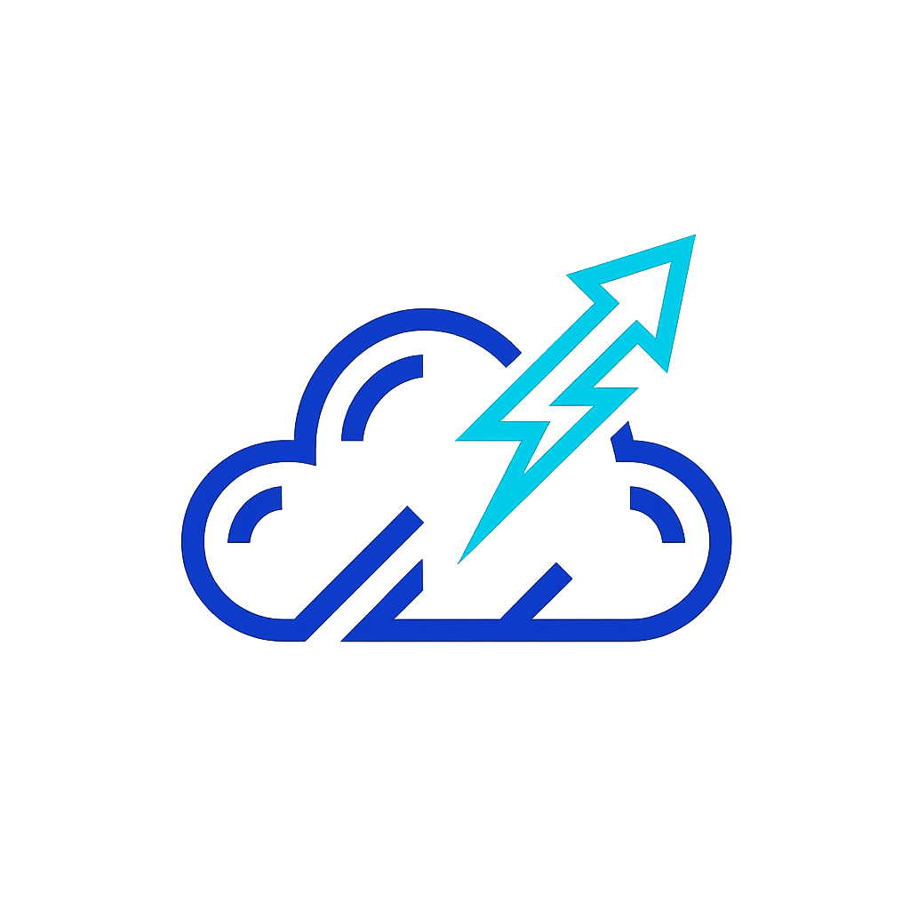
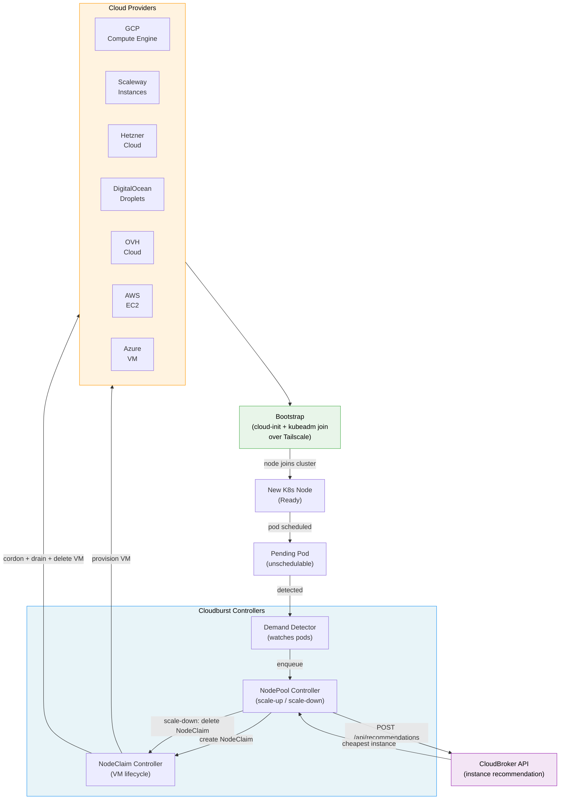

<p align="center">
  
</p>

<h1 align="center">Cloudburst Autoscaler</h1>

<p align="center">
  Kubernetes controller that automatically provisions cloud VMs as worker nodes in response to unschedulable pod demand &mdash; and removes them when no longer needed.
</p>

## Architecture



### How it works

**Scale-up:**

1. A pod is created that cannot be scheduled (insufficient CPU/memory).
2. `DemandDetector` detects the unschedulable pod and enqueues the `NodePool`.
3. `NodePool` controller calculates required capacity and calls [CloudBroker](https://github.com/braghettos/cloudbroker) for the cheapest matching instance.
4. A `NodeClaim` CR is created with the recommended instance details.
5. `NodeClaim` controller provisions a VM on the selected provider (GCP, Scaleway, Hetzner, DigitalOcean, OVH, AWS, or Azure).
6. The VM runs a cloud-init script that installs containerd, kubelet, kubeadm, joins Tailscale, and runs `kubeadm join`.
7. Once the node reports `Ready`, the pending pod is scheduled onto it.

**Scale-down:**

1. `NodePool` controller periodically checks active nodes (every 30s).
2. If a node is empty (no non-DaemonSet pods) and `ttlSecondsAfterEmpty` has elapsed, deletion is triggered.
3. `NodeClaim` controller cordons the node, drains it, deletes the Kubernetes node object, and deletes the cloud VM.

## Features

- **Multi-provider** &mdash; GCP Compute Engine, Scaleway, Hetzner Cloud, DigitalOcean, OVH Cloud, AWS EC2, Azure VM
- **Cost-optimised** &mdash; CloudBroker picks the cheapest instance across all configured providers
- **Automatic lifecycle** &mdash; full scale-up and scale-down without manual intervention
- **Tailscale networking** &mdash; VMs join the cluster over a private Tailscale mesh (works with Kind, EKS, GKE, etc.)
- **CRD-driven** &mdash; NodePool, NodeClass, and NodeClaim resources for declarative configuration
- **Safe scale-down** &mdash; cordon, drain, then delete; respects TTL policies

### Custom Resource Definitions

| CRD | Purpose |
|-----|---------|
| **NodePool** | Scaling policy: instance requirements (CPU, RAM, price, arch, allowed providers), limits (min/max nodes), disruption settings (TTL after empty, TTL until expired). |
| **NodeClass** | Infrastructure config: provider credentials and settings (GCP, Scaleway, Hetzner, DigitalOcean, OVH, AWS, Azure), cluster join config, Tailscale auth, Kubernetes version. Region/zone for provisioning comes from the CloudBroker recommendation; provider region/zone in NodeClass is optional. |
| **NodeClaim** | Represents a single provisioned node. Created automatically by the NodePool controller. Lifecycle: `Pending` &rarr; `Provisioning` &rarr; `Joining` &rarr; `Ready` &rarr; `Deleting`. |

### Controllers

| Controller | Watches | Responsibility |
|-----------|---------|---------------|
| **NodePool** | Pods, NodeClaims, NodePools | Detects unschedulable pods, calculates required capacity, creates/deletes NodeClaims. Periodically re-checks for scale-down. |
| **NodeClaim** | NodeClaims, Nodes | Manages full VM lifecycle: calls CloudBroker, provisions VM with bootstrap script, monitors node join, handles deletion (cordon, drain, delete VM). |
| **NodeClass** | NodeClasses | Validates and reconciles NodeClass configuration. |
| **DemandDetector** | Pods | Enqueues NodePool reconciliation when pod scheduling state changes. |

### Naming Convention

All identifiers for a provisioned node are identical:

```
cb-<nodepool-name>-<random-suffix>
```

- **NodeClaim name** = **K8s Node name** = **Cloud VM instance name**
- The `cb-` prefix identifies Cloudburst-managed resources
- Example: `cb-production-pool-x7kq2`

## Tech Stack

| Layer | Technology |
|-------|-----------|
| Language | Go 1.21+ |
| Framework | controller-runtime (Kubebuilder) |
| CRDs | NodePool, NodeClass, NodeClaim |
| Cloud SDKs | google-cloud-go, scaleway-sdk-go, hcloud-go, godo (DigitalOcean), go-ovh (OVH), aws-sdk-go-v2 (AWS), azure-sdk-for-go (Azure) |
| Networking | Tailscale |
| Bootstrap | kubeadm + cloud-init |
| Containerisation | Docker |
| CI | GitHub Actions (lint, test, Docker build + push to GHCR) |

## Quick Start

### Prerequisites

- Go 1.21+
- Docker
- kubectl
- [Kind](https://kind.sigs.k8s.io/) (for local development)
- [Tailscale](https://tailscale.com/) (for node-to-control-plane networking)
- [CloudBroker](https://github.com/braghettos/cloudbroker) instance running
- Provider credentials (at least one): GCP service account, Scaleway API keys, or Hetzner API token

### Build

```bash
make build              # Build the manager binary
make docker-build       # Build the Docker image
make manifests          # Generate CRD manifests
make generate           # Generate DeepCopy methods
```

### Deploy to a Cluster

Create a `.env` file from `.env.example`:

```bash
cp .env.example .env
# Edit .env with your values:
#   - TAILSCALE_AUTHKEY (required)
#   - GOOGLE_APPLICATION_CREDENTIALS (for GCP)
#   - HETZNER_API_TOKEN (for Hetzner)
#   - SCW_ACCESS_KEY / SCW_SECRET_KEY (for Scaleway)
#   - DIGITALOCEAN_API_TOKEN (for DigitalOcean)
```

**Local Kind deploy (recommended for development):**

```bash
make kind-setup-and-deploy IMG=cloudburst-autoscaler:latest
```

**Build and deploy (auto-detects Kind vs registry):**

```bash
make build-and-deploy IMG=cloudburst-autoscaler:latest
```

**Step-by-step:**

```bash
make create-secrets        # Create namespace and secrets (from .env)
make install               # Install CRDs
make deploy IMG=...        # Deploy the controller
```

### Run Locally

```bash
./hack/create-kind.sh
export TAILSCALE_AUTHKEY=tskey-auth-...
export CLOUDBROKER_BASEURL=http://localhost:8000
make run
```

### Integration Tests

```bash
# Full E2E test (GCP): pod triggers autoscaling, then scale-down
./hack/integration-test-e2e.sh

# Per-provider E2E tests (scale-up + scale-down on a single provider)
./hack/integration-test-e2e-hetzner.sh
./hack/integration-test-e2e-digitalocean.sh
./hack/integration-test-e2e-ovh.sh
./hack/integration-test-e2e-scaleway.sh
./hack/integration-test-e2e-aws.sh
./hack/integration-test-e2e-azure.sh

# All-providers: detect enabled providers from env and list per-provider scripts
./hack/integration-test-e2e-all-providers.sh

# Multi-provider test (GCP + Scaleway)
./hack/test-multi-provider.sh

# NodeClaim lifecycle test (manual NodeClaim creation)
./hack/integration-test.sh
```

## Project Structure

```
.
├── main.go                          # Controller manager entry point
├── api/v1alpha1/                    # CRD type definitions
│   ├── nodeclaim_types.go
│   ├── nodeclass_types.go
│   └── nodepool_types.go
├── internal/
│   ├── controller/                  # Reconciliation logic
│   │   ├── nodepool_controller.go   # Scale-up / scale-down decisions
│   │   ├── nodeclaim_controller.go  # VM lifecycle management
│   │   ├── nodeclaim_deletion.go    # Cordon, drain, delete logic
│   │   ├── nodeclass_controller.go  # NodeClass validation
│   │   └── demand_detector_controller.go
│   ├── bootstrap/                   # VM bootstrap script generation
│   │   ├── join.go                  # kubeadm token + discovery kubeconfig
│   │   └── startup_script.go        # Full cloud-init script builder
│   ├── cloudbroker/                 # CloudBroker API client
│   ├── gcp/                         # GCP Compute Engine provisioner
│   ├── scaleway/                    # Scaleway Instances provisioner
│   ├── hetzner/                     # Hetzner Cloud provisioner
│   ├── digitalocean/                # DigitalOcean Droplets provisioner
│   ├── planner/                     # Capacity planning utilities
│   └── tailscale/                   # Tailscale API client
├── config/                          # Kubernetes manifests (Kustomize)
│   ├── crd/                         # CRD definitions
│   ├── rbac/                        # RBAC rules
│   ├── manager/                     # Controller Deployment
│   ├── cloudbroker/                 # CloudBroker ConfigMap
│   └── samples/                     # Example CRs
├── hack/                            # Development and test scripts
│   ├── create-kind.sh               # Create local Kind cluster
│   ├── integration-test.sh          # NodeClaim lifecycle test
│   ├── integration-test-e2e.sh           # Full E2E test (GCP)
│   ├── integration-test-e2e-hetzner.sh   # E2E test (Hetzner)
│   ├── integration-test-e2e-digitalocean.sh  # E2E test (DigitalOcean)
│   ├── integration-test-e2e-ovh.sh       # E2E test (OVH)
│   ├── integration-test-e2e-scaleway.sh  # E2E test (Scaleway)
│   ├── integration-test-e2e-aws.sh       # E2E test (AWS EC2)
│   ├── integration-test-e2e-azure.sh     # E2E test (Azure VM)
│   ├── integration-test-e2e-all-providers.sh  # Detect enabled providers, list E2E scripts
│   └── test-multi-provider.sh            # Multi-provider test (GCP + Scaleway)
└── docs/                            # Additional documentation
```

## Configuration

### Controller Kubernetes Resources

**CloudBroker ConfigMap** (`cloudbroker-config`):

```yaml
apiVersion: v1
kind: ConfigMap
metadata:
  name: cloudbroker-config
  namespace: cloudburst-system
data:
  baseurl: "http://cloudbroker-service:8000"
  timeout-seconds: "5"
```

**Secrets** (created automatically by `make create-secrets` from `.env`):

| Secret | Key | Description |
|--------|-----|-------------|
| `gcp-credentials` | `credentials.json` | GCP service account JSON key |
| `tailscale-auth` | `authkey` | Tailscale auth key |
| `hetzner-api-token` | `HETZNER_API_TOKEN` | Hetzner Cloud API token |
| `digitalocean-api-token` | `DIGITALOCEAN_API_TOKEN` | DigitalOcean API token |
| `scaleway-credentials` | `SCW_SECRET_KEY`, `SCW_ACCESS_KEY` | Scaleway API keys |
| `ovh-api-credentials` | `OVH_APPLICATION_KEY`, `OVH_APPLICATION_SECRET`, `OVH_CONSUMER_KEY` | OVH API credentials |
| `aws-credentials` | `AWS_ACCESS_KEY_ID`, `AWS_SECRET_ACCESS_KEY` | AWS IAM credentials |
| `azure-credentials` | `AZURE_TENANT_ID`, `AZURE_CLIENT_ID`, `AZURE_CLIENT_SECRET` | Azure Service Principal |

### Environment Variables (local development)

| Variable | Required | Description |
|----------|----------|-------------|
| `TAILSCALE_AUTHKEY` | Yes | Tailscale auth key for node registration |
| `CLOUDBROKER_BASEURL` | No | CloudBroker API URL (default: `http://localhost:8000`) |
| `GOOGLE_APPLICATION_CREDENTIALS` | GCP only | Path to GCP service account JSON key |
| `HETZNER_API_TOKEN` | Hetzner only | Hetzner Cloud API token |
| `DIGITALOCEAN_API_TOKEN` | DigitalOcean only | DigitalOcean API token |
| `SCW_ACCESS_KEY` / `SCW_SECRET_KEY` | Scaleway only | Scaleway API credentials |
| `OVH_APPLICATION_KEY`, `OVH_APPLICATION_SECRET`, `OVH_CONSUMER_KEY`, `OVH_PROJECT_ID` | OVH only | OVH API credentials |
| `AWS_ACCESS_KEY_ID`, `AWS_SECRET_ACCESS_KEY`, `AWS_REGION`, `AWS_AMI` | AWS only | AWS EC2 credentials (IAM user needs EC2 permissions) |
| `AZURE_SUBSCRIPTION_ID`, `AZURE_RESOURCE_GROUP`, `AZURE_SUBNET_ID`, `AZURE_TENANT_ID`, `AZURE_CLIENT_ID`, `AZURE_CLIENT_SECRET` | Azure only | Azure Service Principal and resource IDs |

### Example Resources

```yaml
# Hetzner NodeClass
apiVersion: cloudburst.io/v1alpha1
kind: NodeClass
metadata:
  name: hetzner-standard
spec:
  hetzner:
    location: fsn1
    apiTokenSecretRef:
      name: hetzner-api-token
      key: HETZNER_API_TOKEN
  join:
    hostApiServer: "https://<tailscale-ip>:6443"
    tokenTtlMinutes: 60
  tailscale:
    authKeySecretRef:
      name: tailscale-auth
      key: authkey
  bootstrap:
    kubernetesVersion: "1.34.3"
---
# GCP NodeClass
apiVersion: cloudburst.io/v1alpha1
kind: NodeClass
metadata:
  name: gcp-standard
spec:
  gcp:
    project: my-project
    zone: us-central1-a
  join:
    hostApiServer: "https://<tailscale-ip>:6443"
    tokenTtlMinutes: 60
  tailscale:
    authKeySecretRef:
      name: tailscale-auth
      key: authkey
  bootstrap:
    kubernetesVersion: "1.34.3"
---
# DigitalOcean NodeClass
apiVersion: cloudburst.io/v1alpha1
kind: NodeClass
metadata:
  name: digitalocean-standard
spec:
  digitalocean:
    region: nyc1
    apiTokenSecretRef:
      name: digitalocean-api-token
      key: DIGITALOCEAN_API_TOKEN
  join:
    hostApiServer: "https://<tailscale-ip>:6443"
    tokenTtlMinutes: 60
  tailscale:
    authKeySecretRef:
      name: tailscale-auth
      key: authkey
  bootstrap:
    kubernetesVersion: "1.34.3"
---
# Scaleway NodeClass
apiVersion: cloudburst.io/v1alpha1
kind: NodeClass
metadata:
  name: scaleway-standard
spec:
  scaleway:
    zone: fr-par-1
    projectID: "your-project-id"
    apiKeySecretRef:
      name: scaleway-credentials
      key: SCW_SECRET_KEY
  join:
    hostApiServer: "https://<tailscale-ip>:6443"
    tokenTtlMinutes: 60
  tailscale:
    authKeySecretRef:
      name: tailscale-auth
      key: authkey
  bootstrap:
    kubernetesVersion: "1.34.3"
---
# OVH NodeClass
apiVersion: cloudburst.io/v1alpha1
kind: NodeClass
metadata:
  name: ovh-standard
spec:
  ovh:
    projectID: "your-ovh-project-id"
    applicationKeySecretRef:
      name: ovh-api-credentials
      key: OVH_APPLICATION_KEY
    applicationSecretSecretRef:
      name: ovh-api-credentials
      key: OVH_APPLICATION_SECRET
    consumerKeySecretRef:
      name: ovh-api-credentials
      key: OVH_CONSUMER_KEY
  join:
    hostApiServer: "https://<tailscale-ip>:6443"
    tokenTtlMinutes: 60
  tailscale:
    authKeySecretRef:
      name: tailscale-auth
      key: authkey
  bootstrap:
    kubernetesVersion: "1.34.3"
---
# AWS NodeClass
apiVersion: cloudburst.io/v1alpha1
kind: NodeClass
metadata:
  name: aws-standard
spec:
  aws:
    region: eu-west-1
    ami: ami-xxxxxxxx
    accessKeyIDSecretRef:
      name: aws-credentials
      key: AWS_ACCESS_KEY_ID
    secretAccessKeySecretRef:
      name: aws-credentials
      key: AWS_SECRET_ACCESS_KEY
  join:
    hostApiServer: "https://<tailscale-ip>:6443"
    tokenTtlMinutes: 60
  tailscale:
    authKeySecretRef:
      name: tailscale-auth
      key: authkey
  bootstrap:
    kubernetesVersion: "1.34.3"
---
# Azure NodeClass
apiVersion: cloudburst.io/v1alpha1
kind: NodeClass
metadata:
  name: azure-standard
spec:
  azure:
    subscriptionID: "your-subscription-id"
    resourceGroup: "your-resource-group"
    location: westeurope
    subnetID: "/subscriptions/.../resourceGroups/.../providers/Microsoft.Network/virtualNetworks/.../subnets/default"
    tenantIDSecretRef:
      name: azure-credentials
      key: AZURE_TENANT_ID
    clientIDSecretRef:
      name: azure-credentials
      key: AZURE_CLIENT_ID
    clientSecretSecretRef:
      name: azure-credentials
      key: AZURE_CLIENT_SECRET
  join:
    hostApiServer: "https://<tailscale-ip>:6443"
    tokenTtlMinutes: 60
  tailscale:
    authKeySecretRef:
      name: tailscale-auth
      key: authkey
  bootstrap:
    kubernetesVersion: "1.34.3"
---
# NodePool (works with any provider)
apiVersion: cloudburst.io/v1alpha1
kind: NodePool
metadata:
  name: burst-pool
spec:
  requirements:
    arch: ["x86_64"]
    maxPriceEurPerHour: 0.15
    allowedProviders: ["gcp", "hetzner", "scaleway", "digitalocean"]
  limits:
    maxNodes: 5
    minNodes: 0
  disruption:
    ttlSecondsAfterEmpty: 300
    ttlSecondsUntilExpired: 3600
```

## Documentation

- [Article series](docs/articles/) &mdash; four-part intro (problem and product, how it works, interface, scope and run)
- [Architecture](docs/architecture.md) &mdash; CRD design, controller interaction, bootstrap process, networking
- [Multi-Provider Testing Guide](hack/MULTI_PROVIDER_TEST.md) &mdash; testing with GCP and Scaleway simultaneously

## License

Apache License 2.0
