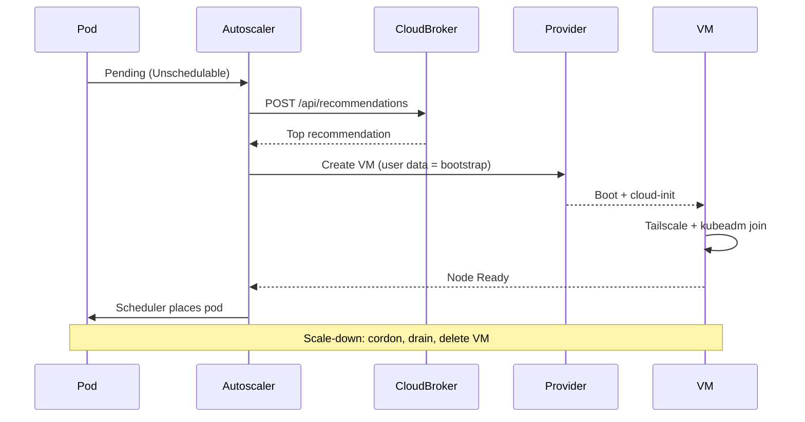
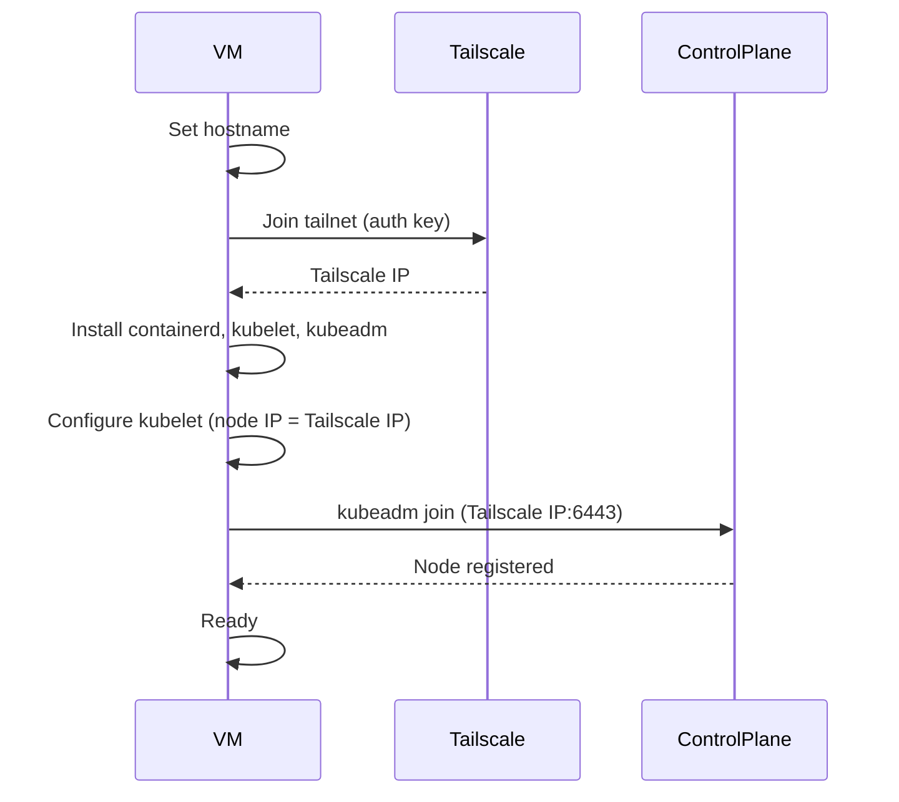

# From Pending Pod to New Node: The Cloudburst Autoscaler Flow

**How it works: demand → recommendation → provision → bootstrap → join → scale-down.**

---

The trigger is an unschedulable pod. The Autoscaler aggregates demand (how much CPU and RAM are needed), sends that to the recommendation API with constraints from your policy (allowed providers, max price, region), and gets back a target: "create this instance type, in this region, on this provider." It creates the VM with a bootstrap script that installs Tailscale (so the VM can reach the control plane), then containerd, kubelet, kubeadm, and runs `kubeadm join`. The VM becomes a node; the pod schedules. When the node is empty long enough, the controller tears it down. This piece is the "what happens, step by step."



---

## The trigger: unschedulable pods

Kubernetes leaves the pod **Pending**. The Autoscaler aggregates demand — how much vCPU and RAM do all unschedulable pods need? — and calls the recommendation API with min vCPU, min RAM, arch, region, max price, and **allowed providers** from your policy (NodePool). The API returns the top recommendation. The Autoscaler now has a target: "create this instance type, in this region, on this provider." It looks up a NodeClass that supports that provider (credentials and config for that cloud), creates a **NodeClaim** (the object that represents one burst node from creation to deletion), and passes it the recommendation and the chosen NodeClass.

---

## Provisioning and bootstrap

The Autoscaler creates the VM on the chosen provider (GCP, AWS, Azure, Hetzner, Scaleway, DigitalOcean, or OVH). It passes **user data**: a script that runs once at first boot (cloud-init or the provider's equivalent).

**Why Tailscale?** Burst nodes live in arbitrary clouds and networks. The control plane might be a Kind cluster on a laptop, or EKS in a VPC. Direct connectivity would require opening ports or managing a VPN. Tailscale gives every machine an identity and a secure path to every other machine in your **tailnet**. The VM joins with an auth key from a Kubernetes secret (referenced in the NodeClass). Once on the tailnet, it reaches the API server at the Tailscale IP you configured — e.g. the host's Tailscale IP and port 6443. No per-provider firewall dance.

**What runs on first boot:** The script sets the **hostname** to the NodeClaim name (so the Kubernetes node name matches the VM). It installs and configures **Tailscale** with the auth key and gets a Tailscale IP. It installs **containerd**, **kubelet**, and **kubeadm** at the version in the NodeClass. It configures kubelet to use the Tailscale IP as the node IP and the same cgroup driver as the cluster. Then it runs **kubeadm join** with discovery info pointing at the control plane's Tailscale address. The join token and discovery material are generated by the Autoscaler and embedded in the script. No long-lived agent; everything needed for join is in that one script.



---

## From Joining to Ready

The Autoscaler watches the cluster for a new node with the expected name (the NodeClaim name). When that node's **Ready** condition is true, the controller marks the NodeClaim as Ready. The scheduler sees the new capacity and places the pending pod onto it. Demand → recommendation → VM → bootstrap → node Ready → pod scheduled.

---

## Scale-down

When the node has no workloads (except system daemons) and has been empty for the configured time (e.g. in NodePool: `ttlSecondsAfterEmpty`), the Autoscaler marks the NodeClaim for deletion. It **cordons** the node (no new pods), **drains** it (evicts remaining workloads gracefully), deletes the Kubernetes node object, and calls the provider API to delete the VM. Billing stops. The cluster shrinks back.

**Watch the flow from the cluster:**

```bash
kubectl get pods -A | grep Pending
kubectl get nodeclaims -A
kubectl get nodes -l cloudburst.io/provider
```

---

That's the mechanism. The next piece is the interface: how you configure it — NodePool, NodeClass, and NodeClaim.
