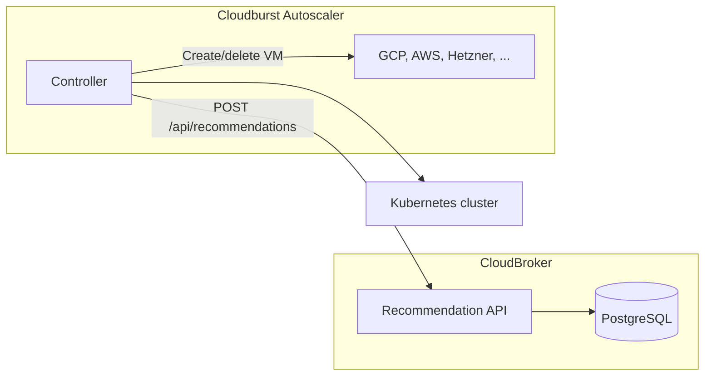

# Cloudburst Autoscaler: Scope, Limits, and How to Run It

**The full picture: what's in, what's out, and how to get from zero to burst.**

---



*CloudBroker = price brain; Cloudburst = provisioner; both self-hosted.*

We've covered the problem and the product, how it works (flow and bootstrap), and the interface (NodePool, NodeClass, NodeClaim). This piece is the capstone: the full scope of Cloudburst Autoscaler, the boundaries, and a short "run with CloudBroker" path so you can try it.

---

## The combined scope

The project delivers **automatic, cost-aware, multi-cloud burst capacity** on Kubernetes. When a pod can't be scheduled, the system detects the demand, asks CloudBroker for the cheapest suitable instance across seven providers, provisions that VM on the right cloud, bootstraps it (Tailscale + Kubernetes join), and waits for the node to be Ready. The pod is scheduled; the job runs. When the pod is gone and the node has been empty long enough, the controller cordons, drains, deletes the node, and deletes the VM. Billing stops. All of that is automatic. Cost is an input to the decision — the "where" and "what" come from the recommendation API. No manual resizing. No single-cloud default.

---

## What's out of scope

A few boundaries keep the system focused. The project does **not** resize managed node groups (e.g. "add one to my GKE pool" or "scale my EKS node group"). It creates **standalone** VMs and turns them into nodes so it can use any of the seven providers, including ones that don't host your main cluster. It does **not** use serverless burst (Fargate, Cloud Run, Azure Container Instances); capacity is always a normal VM running kubelet. It does **not** replace or manage your control plane; it only adds and removes worker nodes. It does **not** re-provision every few minutes to chase the lowest possible price; it uses the recommendation at the moment it needs to scale up. One Autoscaler instance serves **one** cluster — no multi-cluster orchestration. And both CloudBroker and Cloudburst are **self-hosted** in this project; there's no SaaS offering. You run them, you own the data and the credentials.

---

## How to run both

Minimal sequence. **(1)** Run **CloudBroker**: clone the repo, set up `.env`, start the stack (e.g. `make up`), run migrations and seed (`make migrate`, `make seed`), then run ingestion for the providers you care about (`make ingest-hetzner`, `make ingest-all`, etc.). The recommendation API is now live. **(2)** Deploy **Cloudburst Autoscaler** into your Kubernetes cluster (or run it locally against the cluster). Point it at the cluster and at CloudBroker's URL. Ensure it has the credentials it needs for the providers you allow — those live in NodeClasses and in secrets (e.g. GCP service account, Hetzner API token). **(3)** Create at least one **NodeClass** (per provider you'll use) with join config, Tailscale auth key reference, and bootstrap version. **(4)** Create at least one **NodePool** with allowed providers, max price, and disruption settings. **(5)** Create a workload that can't be scheduled — e.g. a pod that requests more CPU than any existing node has. Watch the Autoscaler create a NodeClaim, provision the VM, wait for join, and schedule the pod. **(6)** Delete the workload. Watch scale-down: cordon, drain, delete node, delete VM. For detailed steps and per-provider manifests, the project's README and the provider testing guide in the docs have the full walkthrough.

**Example: run both from scratch**

```bash
# 1. CloudBroker (from cloudbroker repo)
cp .env.example .env
make up && make migrate && make seed
make ingest-hetzner   # or ingest-gcp, ingest-all, etc.

# 2. Cloudburst Autoscaler (from cloudburst-autoscaler repo)
# Install CRDs and run the controller (see README for deploy steps)
kubectl apply -f config/crd/bases/
# Create secrets (Tailscale auth, provider API keys), then:
kubectl apply -f config/samples/nodeclass-scaleway.yaml
kubectl apply -f config/samples/nodepool-scaleway.yaml

# 3. Trigger burst: create a pod that can't be scheduled
kubectl apply -f config/samples/workload-scaleway.yaml
kubectl get nodeclaims
kubectl get nodes -l cloudburst.io/provider

# 4. Scale-down: delete the workload
kubectl delete -f config/samples/workload-scaleway.yaml
# After ttlSecondsAfterEmpty, node and VM are removed
```

Sample manifests live in `config/samples/` (NodePool, NodeClass, secrets, and a high-resource workload that triggers provisioning).

---

## Summary and closing

**CloudBroker** is the price brain. **Cloudburst Autoscaler** is the provisioner. Together they give Kubernetes automatic, cost-aware, multi-cloud burst capacity. This series has walked through the problem and the product, how it works (flow and bootstrap), the interface (NodePool, NodeClass, NodeClaim), and scope. For operators who want to reduce toil and avoid single-cloud lock-in, the stack is ready to run. The cluster doesn't just scale — it shops.
